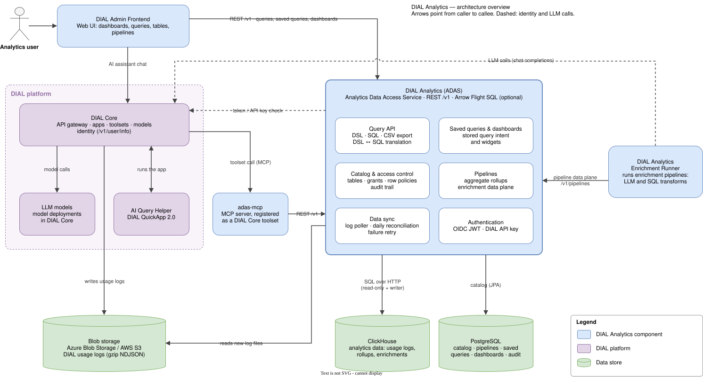

# Architecture overview

DIAL Analytics turns DIAL usage logs into governed, queryable analytics data. ADAS (the Analytics Data
Access Service, this repository) sits at the centre: it ingests the logs, owns the catalog, and is the only
component that talks to the data stores. Every other DIAL Analytics component reaches the data through the
ADAS API.

Arrows point from caller to callee. Dashed arrows are identity checks and LLM calls.

## Components

| Component | Role |
|---|---|
| **DIAL Admin Frontend** | Web UI for analytics users: dashboards, saved queries, ad-hoc queries, tables, pipelines and the AI query helper. |
| **ADAS** | Runtime gateway between analytics consumers and the data stores. It serves the structured query DSL, SQL, CSV export and DSL ↔ SQL translation under `/v1/queries`, plus saved queries, dashboards, the table catalog, pipelines and data sync. Arrow Flight SQL is an optional second transport for BI clients. |
| **DIAL Analytics Enrichment Runner** | A separate service that drives enrichment pipelines. It pages source rows from ADAS, computes enrichment values (LLM or SQL transforms), and writes them back through the pipeline data plane. It keeps its own state in a separate PostgreSQL database. |
| **adas-mcp** | MCP server that exposes ADAS schema discovery, translation and query execution as AI tools. It is registered in DIAL Core as a toolset. |
| **AI Query Helper** | DIAL QuickApp 2.0 application that turns a user's question into an ADAS query, using LLM models and the adas-mcp toolset through DIAL Core. |
| **DIAL Core** | DIAL platform gateway. It hosts the QuickApp, routes model and toolset calls, introspects DIAL API keys and tokens for ADAS (`/v1/user/info`), and writes usage logs to blob storage. |
| **Blob storage** | Azure Blob Storage or AWS S3 holding DIAL usage logs as gzip NDJSON files. |
| **ClickHouse** | Analytics data: ingested usage logs, aggregate rollups and enrichment tables. |
| **PostgreSQL (ADAS)** | ADAS catalog: table definitions and column exposure, grants and row policies, pipelines, saved queries, dashboards and the audit trail. |
| **PostgreSQL (Runner)** | The Enrichment Runner's own runtime state: its job queue, per-pipeline scan cursors, group state for group-trigger pipelines, backfill run history, dead-letter items and LLM spend counters. It holds no analytics data, and ADAS does not access it. |

## Main flows

1. **Ingestion.** DIAL Core writes usage logs to blob storage. The ADAS data-sync poller picks up new
   files in near real time, and a daily reconciliation catches anything the poller missed. Rows are
   written to ClickHouse, and failed blobs are recorded for retry
   ([data-sync](../openspec/specs/data-sync/spec.md),
   [data-sync-failures](../openspec/specs/data-sync-failures/spec.md)).
2. **Querying.** The frontend calls ADAS `/v1` to run queries and to load saved queries and dashboards.
   ADAS resolves entities from the PostgreSQL catalog, applies access control, and reads ClickHouse with
   a read-only credential ([structured-query](../openspec/specs/structured-query/spec.md),
   [table-access-control](../openspec/specs/table-access-control/spec.md)).
3. **AI query help.** The frontend sends the user's question to the AI Query Helper through the
   DIAL Core API. The QuickApp calls LLM models and the adas-mcp toolset through DIAL Core. adas-mcp calls
   ADAS for the schema, query translation and execution.
4. **Enrichment.** The Enrichment Runner calls the ADAS pipeline data plane under `/v1/pipelines` (scan,
   group-rows, materialize, rows) and calls LLM models through DIAL Core. ADAS writes the results to
   ClickHouse with its writer credential
   ([enrichment-runtime](../openspec/specs/enrichment-runtime/spec.md),
   [class1-enrichment](../openspec/specs/class1-enrichment/spec.md)).
5. **Authentication.** Callers present an OIDC JWT or a DIAL API key. ADAS validates JWTs itself and
   checks API keys and opaque tokens with DIAL Core ([authentication](../openspec/specs/authentication/spec.md)).

Not shown: BI tools such as Grafana and Power BI that query ADAS directly over REST or Flight SQL
([flight-sql-endpoint](../openspec/specs/flight-sql-endpoint/spec.md)), and OpenTelemetry exporters
that push into ADAS OTLP sinks ([otel-sink](../openspec/specs/otel-sink/spec.md)).

## Editing the diagram

`architecture.drawio.svg` is an SVG image with the editable draw.io model embedded in it. GitHub and
Markdown previews render it as a normal image, and draw.io opens the same file for editing. Use any of:

- the draw.io desktop app or <https://app.diagrams.net> (*File → Open*),
- the *Draw.io Integration* extension in VS Code,
- the *Diagrams.net Integration* plugin in IntelliJ IDEA.

Save it back in the same `.drawio.svg` format so the image and the model stay in one file.
